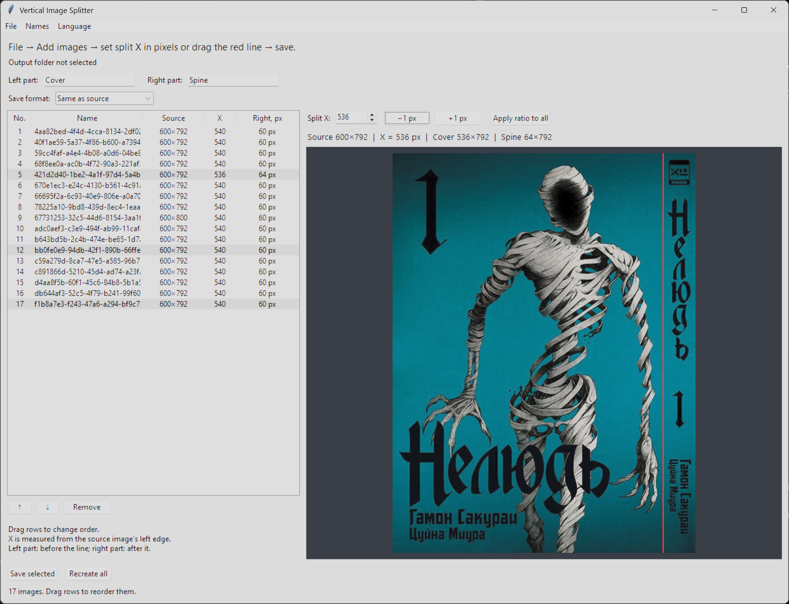

# Vertical Image Splitter

**[English](README.md)** · [Русский](README.ru.md) · [Español](README.es.md) · [Deutsch](README.de.md) · [Français](README.fr.md) · [Português (Brasil)](README.pt_BR.md) · [Italiano](README.it.md) · [简体中文](README.zh_CN.md) · [日本語](README.ja.md) · [한국어](README.ko.md) · [Türkçe](README.tr.md) · [Polski](README.pl.md)

Aplicación de escritorio para dividir **cualquier imagen en dos partes verticales**. Las portadas y los lomos de libros son solo un ejemplo; puedes elegir los nombres de las partes.



## Características

- Corte preciso: escribe la coordenada X o arrastra la línea roja de la vista previa.
- Procesa archivos o carpetas en lote. Usa **Ctrl+clic** para elegir varias filas y **Guardar selección**.
- Reordena las filas arrastrándolas, aplica la misma proporción a todas las imágenes y ajusta cada una.
- Guarda en el formato original o en PNG, TIFF, JPEG, WebP, BMP o GIF.
- Nombre de serie y numeración de volúmenes opcionales.
- Los originales no se modifican y se hacen copias de seguridad de los resultados reemplazados.

## Instalación y ejecución

**Windows:** instala Python 3.10+ con Tkinter y ejecuta `start.bat`. El iniciador instala Pillow si hace falta.

**Linux/macOS:** instala Python 3.10+ y Tkinter (en Linux puede requerir `python3-tk`) y ejecuta:

```sh
python3 -m pip install -r requirements.txt
python3 cover_splitter.py
```

## Uso

1. Abre **Archivo → Añadir imágenes…** o **Añadir carpeta…**.
2. Selecciona **Archivo → Carpeta de destino…**.
3. Escribe los nombres de las partes izquierda y derecha (por defecto: **Portada** y **Lomo** en español).
4. Selecciona el formato, **Igual que el original** por defecto.
5. Opcionalmente define la serie y el primer volumen desde **Nombres**.
6. Introduce X en píxeles o mueve la línea roja; usa ±1 px para ajustar.
7. Selecciona varias filas con Ctrl (Shift para un intervalo) y pulsa **Guardar selección** o **Recrear todas**.

## Archivos generados

Para `example.png`, sin serie, el ejemplo con nombres en inglés es:

```text
output/
  example/
    example - Cover.png
    example - Spine.png
```

Con una serie se crea una subcarpeta por volumen, como `My Series. Vol. 1/` en inglés. Puedes cambiar ambos nombres.

## Tratamiento de imágenes

Solo se escala la vista previa. Los resultados se recortan exactamente en los píxeles de origen. JPEG usa calidad 100, WebP compresión sin pérdidas y TIFF compresión sin pérdidas. Los TIFF multipágina y las animaciones se procesan por fotograma si el formato de salida lo permite. Convertir puede alterar la paleta, el modo de color o los metadatos.

## Idiomas y ajustes

En el primer inicio aparece **inglés**, independientemente del sistema. Cambia el idioma en el menú **Idioma**; el cambio es inmediato y se guarda en `settings.json`. Los nombres personalizados no se sobrescriben. No hay detección automática ni traducción en línea.

## Privacidad y copias de seguridad

Todo se procesa localmente, sin subir imágenes. Los originales permanecen intactos. Antes de reemplazar archivos existentes, se copian a una carpeta fechada `Previous images/`. `settings.json` contiene rutas locales y está excluido del repositorio mediante `.gitignore`.
